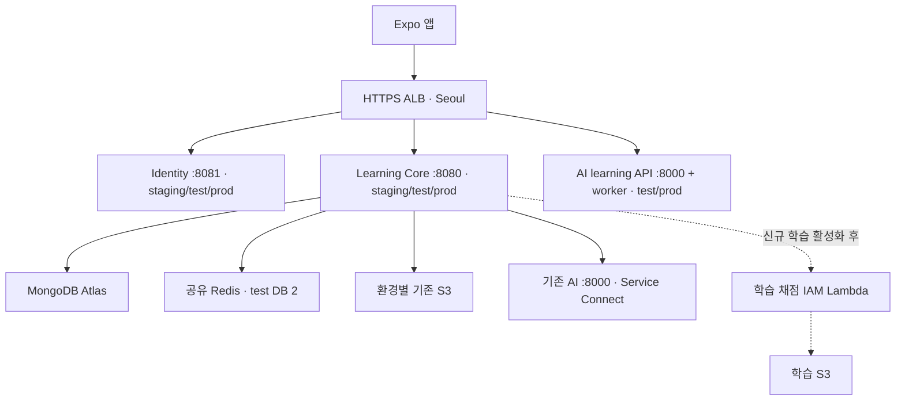

# 답변 익히기 합류·배포 인수인계 — 2026-10-13

## 최종 코드 점검: 학습 전용 코드에서 2건 수정 완료

2026-10-13 검토에서 재현한 다음 두 문제를 수정했다. 이번 수정의 런타임 범위는 신규 학습 패키지의 `LearningService`, `LearningStore`, `LearningWorker` 3개 파일이다. 기존 공통 소유권/삭제 구현, API·DTO, 설정·의존성·DB 스키마는 추가 변경하지 않았다.

- **삭제로 차단된 작업 뒤의 다른 사용자 처리:** 한 tick당 최대 10개 조회를 유지하면서 `(nextRunAt, _id)` 커서로 다음 묶음을 확인한다. 고정된 조회 시각의 순회가 끝나면 처음부터 다시 확인한다. 차단된 사용자 문서는 수정하지 않는다. 격리 Mongo 회귀 검사에서 차단된 40개 뒤의 정상 제출을 처리하고, 차단 해제 후 앞선 작업도 처리하는 것을 확인했다.
- **동시 제출/재시도의 일일 한도 중복 차감:** 기존 owner 트랜잭션 안에서 insert/attempt 조건부 갱신과 quota를 함께 확정한다. 생성 전 중복을 다시 확인하며 실제 상태 전환에 성공한 경우만 차감한다. 실제 Mongo replica set·production owner fence를 사용한 5개 검사로 중복 생성/재시도, 마지막 한도 경합, 한도 초과 시 생성/attempt 롤백을 확인했다.

검증 결과:

- 현재 브랜치 `clean test mongoIntegrationTest`: Java 689개(조건부 콘텐츠 fixture 1개 skip), Mongo 157개, 실패·오류 0. 해당 fixture는 전체 비공개 콘텐츠로 별도 통과했다.
- 최신 develop `3d50195`와 전체 학습 변경을 합친 임시 복사본: Java 908개(같은 조건부 fixture 1개 skip), Mongo 160개, 실패·오류 0.
- 실제 서버 DTO → 프론트 스키마: 목록 13개·상세 520개·답안 1,000개·콘텐츠 버전 1개 일치.

최신 develop과 **런타임 파일의 병합 충돌은 없으며** `application.yml`은 양쪽 설정을 보존해 자동 병합됐다. 공통 기록 `docs/codex/CURRENT_STATE.md`와 `WORKLOG.md`는 같은 위치에 양쪽 기록을 추가해 텍스트 충돌이 남는다. 양쪽 이력을 보존한 적용용 파일을 로컬 `build/answer-learning-conflict-fix-20261013/resolved-docs/`에 준비했다. 이는 현재 `3d50195` 기준 파일이므로 실제 머지 시 기준이 바뀌었다면 다시 대조해야 한다. 원래 브랜치와 index를 보존했으며 rebase/merge는 실행하지 않았다.

전체 검증 수치·병합 검사·수정 범위 증거는 Git 제외 `build/answer-learning-conflict-fix-20261013/`에 있다. 이전 실패 재현 이력은 `build/answer-learning-final-review-20261013/`에 보존했다. 이번에는 AWS/DB 배포·실제 음성·모델 호출·commit/push를 수행하지 않았다. 새 백엔드 이미지 배포 후 실제 앱 종단 검증이 필요하다.

## 5줄 결론

1. 프론트는 기존 앱의 학습 탭에 연결됐고, 백엔드는 기존 Learning Core의 `/api/v1/learning` 10개 API를 구현했다. 별도 앱으로 다시 이식할 작업이 아니다.
2. 프론트 `feat/answer-learning` → `main`, 백엔드 로컬 `feat/answer-learning` → `develop`이 전달 대상이다. 백엔드 `develop` 머지는 테스트 ECS 배포를 시작한다.
3. 현재 **코드 검사 통과와 서비스 출시 준비 완료는 다르다**. 테스트 DB 콘텐츠, 계정 통합·기록 삭제 코드·자동 검증, task role 권한, 최신 Lambda 배포와 테스트 ECS 채점 활성화 설정은 완료했다. 새 백엔드 코드 배포와 실제 앱 종단 검증은 남아 있다.
4. 현행 배포 workflow는 현재 task definition의 **이미지만 교체**한다. `.env.example`만 머지해도 ECS 환경변수나 IAM 권한이 생기지 않는다.
5. 사용자 승인으로 테스트 DB의 학습용 6개 컬렉션, 테스트 task role 권한, 학습 전용 Lambda 2개와 테스트 ECS 환경변수 9개를 순차 적용했다. 기존 실행 이미지, S3 버킷 정책, 기존 staging/prod 서비스와 운영 DB는 변경하지 않았다.

## 반드시 읽을 내용

### 전달 범위와 대상

| 구분 | 전달 코드 | 기준/현재 상태 |
| --- | --- | --- |
| 앱 | `app-front-end`, `feat/answer-learning` | `3e17478` 기반, HEAD `831cd635` + 로컬 휴대폰 어댑터/계정 통합 캐시 갱신·세션 유지 변경. 10/13 최신 main `ab1c708`과 merge-tree 충돌 없음 |
| 백엔드 | `app-back-end-learning-core`, 로컬 `feat/answer-learning` | develop `b2b37ff` 기반, 최신 `3d50195` 합류 검사 통과. 사용자 선택대로 commit/push하지 않은 변경도 반드시 전달해야 함 |
| 데이터 | 서버용 별도 전달 | 200카드·360문항·1,000답안·2,756미디어. 전체 콘텐츠는 공개 Git에 넣지 않음 |
| 체크리스트 | 서버용 별도 전달 | `question-checklists-20261012-v1`, Part 2~5 320문항·721항목. 로컬 및 Atlas 테스트 DB 반영 완료. 운영 DB의 기존 9개 기준은 이번에 변경하지 않음 |
| Lambda | 이 브랜치 `lambda/answer-learning/` | 전용 intake/worker/설정/배포 템플릿/합성 테스트 포함. 최신 테스트 배포·삭제 계약 검증 완료. [빌드와 배포 기록](../../lambda/answer-learning/README.md). 프론트에 Lambda 주소/모델 키를 전달하지 않음 |

백엔드 로컬 브랜치는 **브랜치 이름만 전달하면 코드가 전달되지 않는다**. 미커밋 파일을 검토·커밋한 뒤 PR을 만들거나 제공된 패치를 적용해야 한다. 현재 문서를 GitHub에서 읽을 수 있다는 전제로 안내하지 않는다.

### 실제 서버 매핑

조회 시점: 2026-10-13 10:55~11:08 KST. 계정 `889384901776`, 서울 `ap-northeast-2`.

| 환경 | 앱의 Learning Core 주소 | ECS 서비스 | Mongo DB | 기존 녹음 버킷 |
| --- | --- | --- | --- | --- |
| 테스트 | `https://api-test.to-teacher.com` | `tosunsaeng-learning-core-test-service` | `to-teacher-learning-core-test` | `tosunsaeng-test-audio` |
| 기존 staging | `https://api-staging.to-teacher.com` | `tosunsaeng-learning-core-service` | `to-teacher-app` | `to-teacher-exam` |
| prod | `https://api-prod.to-teacher.com` | `tosunsaeng-learning-core-prod-service` | `to-teacher-app` | `to-teacher-exam` |

- 신규 학습 API는 기존 host의 `/api/v1/learning/*`이므로 ALB 라우팅을 추가할 필요가 없다.
- 기존 staging/prod의 DB 이름과 기존 녹음 버킷이 같다. 이름만 보고 데이터가 격리됐다고 가정하지 않는다. staging/prod Mongo 연결 비밀 값은 조회하지 않았으므로 DB 이름만으로 같은 클러스터라고 확정하지 않는다. 테스트 DB 연결은 별도로 확인했다.
- 테스트 Identity 주소는 `https://identity-test.to-teacher.com`, audience는 `tosunsaeng-learning-core`, 인증 모드는 JWT다. 테스트 앱은 두 API 주소를 함께 테스트 환경으로 맞춘다.
- **prod Learning Core의 현재 issuer는 `https://identity-staging.to-teacher.com`이다.** `identity-prod`라는 호스트가 있다고 issuer를 임의 변경하지 않는다. 실제 prod 앱 설정과 토큰의 신뢰 관계를 별도 검증해야 한다.
- 백엔드 `main` workflow 대상은 `tosunsaeng-learning-core-service`이며 **prod-service가 아니다**. develop은 PR merge일 때 테스트 자동 배포한다. prod 승격 경로는 이번 작업에서 바꾸지 않는다.

### 합류 순서와 통과 조건

| 순서 | 담당 | 필요한 결과 | 현재 상태 |
| --- | --- | --- | --- |
| 1 | 프론트·백엔드 | 두 브랜치 전체 변경 수령, 최신 기준 충돌 확인, API 계약 고정 | 자동 검사 통과, backend commit/push 보류 |
| 2 | 백엔드 | 기존 계정 통합/학습 기록 삭제에 신규 사용자 데이터 연결 및 테스트 | **코드·자동 검증 완료** — 소유권 이전·중복 완료 병합·삭제·늦은 결과 차단 |
| 3 | 데이터 담당 | 테스트 DB에 지정 dataset/version 및 전체 320개 기준 반영 | **완료** — 테스트 DB 6개 컬렉션, 4,637문서 전체 재조회 일치, S3 2,756객체 HEAD 검증 |
| 4 | 인프라 담당 | 테스트 task role에 전용 S3 prefix·Lambda 호출 권한 부여 | **완료(10/13)** — 기존 정책 보존, 추가 정책/실제 역할 각각 18개 검사 통과 |
| 5 | 백엔드·인프라 | 활성화 설정 주입 후 develop PR merge/테스트 배포 | **Lambda·설정 완료(:26, grading=true)**. 새 backend 이미지 배포는 남음 |
| 6 | 프론트·QA | 실제 JWT + 네이티브 앱으로 전체 흐름 확인 | 샘플/로컬 검증과 구분하여 수행 필요 |
| 7 | 릴리스 담당 | 검증된 서버 버전과 앱 네이티브 빌드 승격 | 미수행 |

**코드 이식이나 API 필드 재조립은 필요 없다.** IAM·Lambda·ECS 학습 설정은 완료했고, 백엔드 브랜치 전달·develop PR 배포 → 새 네이티브 빌드와 실제 JWT 검증이 남는다. 로컬 iOS 전체 앱은 로그인까지 확인됐으나 서버 연동 종단 검증은 별도다. 코드 머지만으로 설치 앱의 네이티브 모듈이 바뀌지는 않는다.

## 결정이 필요한 사항

- 기존 계정 통합/기록 삭제에 새 완료·제출·녹음·Lambda 전사/결과를 포함하도록 구현했다. 기존 삭제 API를 유지하며 프론트의 기존 설정 화면에 아직 없는 삭제 UI를 임의로 추가하지 않았다.
- 테스트와 prod의 학습 녹음/채점 저장소를 어떻게 격리할지 정한 뒤 권한을 적용한다. 현재 준비된 `tosunsaeng-app-audio`와 staging Lambda를 prod에 자동 재사용하지 않는다.
- backend는 로컬 브랜치 유지가 현재 사용자 결정이다. 담당자의 커밋/PR 없이는 GitHub develop에 합류하지 않는다.

## 주요 위험과 미확인 사항

### 이번 브랜치에서 해결한 통합 누락

- `LearningOwnership.merge`를 기존 UserMerged 트랜잭션 안에서 호출한다. 두 계정 guard 획득 후 제출 소유권을 옮기고 이전 worker lease를 해제한다. 같은 문항/등급/버전의 완료가 양쪽에 있으면 최초 완료 증거만 남긴다.
- 완료 저장은 사용자·문항·등급·버전 고유 키로 멱등 처리하되 삭제 후에는 새 문서 ID를 만든다. 이전 삭제 manifest가 새 학습 완료를 지우지 않는다. 채점 완료 root와 완료 행은 같은 owner 트랜잭션에서 변경하며 실패 시 함께 롤백한다.
- 삭제 manifest에 `LEARNING_SUBMISSION`, `LEARNING_COMPLETION`을 추가했다. Part 1 완료도 포함한다. 외부 쓰기는 제한된 기간에만 허용하며, 업로드 URL 만료는 guard 안에서 기록한 발급 시점에 묶인다. 삭제 준비 완료 후 새 학습을 허용한다.
- 삭제 worker는 Lambda에 `DELETE /v1/learning/evaluations/{submissionId}`를 IAM 서명으로 요청한다. 1~3회 시도 모두 개인정보 없는 30일 tombstone으로 교체한 뒤 해당 제출의 S3 임시/고정 prefix와 모든 버전을 제거한다. 늦은 SQS·전사·모델 응답은 기존 결과를 되살리지 못한다. 404/누락된 설정을 삭제 성공으로 처리하지 않는다.
- 새 학습 기능을 OFF로 바꿔도 기존 데이터의 소유권 이전/삭제 코드는 작동한다. 정리에 필요한 `ANSWER_LEARNING_S3_BUCKET`, `ANSWER_LEARNING_LAMBDA_URL`과 권한은 제거하지 않는다. 신규 학습 활성화에는 기존 owner transaction fence가 필수다.
- 프론트는 계정 통합 완료 시 캐시를 갱신하고, 진행 중 문항·음성 타이밍·콘텐츠 버전은 진입 시점의 묶음을 유지한다. 캐시 재조회가 녹음/따라 말하기 화면을 초기화하지 않는다.

위 통합 코드는 **로컬 합성 데이터·격리 Mongo 테스트로 검증한 구현 사실**이다. 10/13 후속 작업으로 Lambda의 새 삭제 계약도 배포해 합성 ID로 반복 삭제·늦은 worker 차단을 확인했다. 기존 앱의 실제 JWT를 사용한 계정 통합/기록 삭제 종단 검증은 새 백엔드 배포 후 별도로 수행한다.

### 현재 환경에서 기능이 바로 켜지지 않는 이유

- 테스트 task definition은 `tosunsaeng-learning-core-test:26`으로 전환 완료했다. 기존 환경변수 48개·실행 이미지 유지, 학습 변수 9개 추가, enabled=true/grading=true다. 최신 Lambda는 배포했지만 새 학습 코드를 포함한 백엔드 이미지는 아직 배포하지 않았다.
- 초기 조회에는 테스트 task role의 기존 인라인 정책 3개만 있었다. 10/13 후속 요청으로 이를 보존하면서 `LearningCoreTestAnswerLearningS3` 및 학습 Lambda 호출 관리형 정책을 추가했다. 14:12 KST Lambda 및 ECS 활성화 검증까지 완료했다. 다른 서비스 9개의 설정은 유지됐으며, 이미 진행 중이던 테스트 Identity 배포의 독립적 완료는 이번 변경과 구분한다. [적용·검증 내역](test-release.md)을 따른다.
- 학습 Mongo 컬렉션은 기본 `MongoTemplate`의 DB에서 조회한다. 기존 `to-teacher-app`에 콘텐츠를 올렸다는 기록이 있어도 **테스트 DB에 자동 복제되지 않는다**. 이 때문에 기존 MONGODB_DATABASE를 바꾸면 안 된다.
- 이번 테스트 DB에는 대상 6개 컬렉션이 없어 새 320개 prepared 기준을 충돌 없이 추가했다. 운영 DB에는 기존 9개 trial 기준이 있으므로 이후 운영 반영은 별도의 버전 전환/이전 prepared 비활성화가 필요하다.

## 구현·검증 설명

계약 원문: [api.md](api.md), 코드·환경변수·권한 예시: [README.md](README.md).

필수 backend 설정은 README의 `ANSWER_LEARNING_*` 예제를 사용한다. `scripts/answer-learning/prepare_test_release.py`는 현재 테스트 task definition을 읽어 학습 환경변수만 추가한 등록 입력을 로컬에 생성한다. [환경 적용 절차](test-release.md)를 따른다. **기존 `AWS_S3_BUCKET_NAME`, `MONGODB_DATABASE`, `AI_SERVER_URL`, `CHALLENGE_AI_ENDPOINT`, JWT issuer를 신규 학습용 값으로 덮어쓰지 않는다.** 기존 모의고사/챌린지의 설정이다.

프론트 일반 실행에 필요한 변경은 API 주소와 기존 앱 설정뿐이다:

```dotenv
EXPO_PUBLIC_IDENTITY_API_BASE_URL=https://identity-test.to-teacher.com
EXPO_PUBLIC_LEARNING_API_BASE_URL=https://api-test.to-teacher.com
```

`LEARNING_SAMPLE`, `LEARNING_DEVICE_BACKEND`, `EXPO_PUBLIC_LEARNING_DEVICE_SESSION`은 개발 샘플 전용이다. 출시 앱에 넣지 않는다. STT 네이티브 모듈이 추가되므로 기존 앱에 JS OTA만 보내서는 안 되며 iOS/Android 새 네이티브 빌드가 필요하다.

### 계약을 재현하는 오프라인 검증

백엔드에서 서버 DTO를 생성한다. PRIVATE_IMPORT_DIRECTORY는 6개 learning_*.json이 들어 있는 서버 전달 폴더다. `LearningImportedContentTest`는 Mongo/S3를 mock하고 실제 서버 catalog 코드를 실행한다.

```sh
LEARNING_IMPORT_FIXTURES="$PRIVATE_IMPORT_DIRECTORY" ./gradlew test --tests '*LearningImportedContentTest' --rerun-tasks
```

프론트 checkout에서 아래 명령으로 실제 앱 Zod 스키마/파트·등급·문항 대응을 검증한다. 전체 자료/서명 URL은 출력하지 않는다.

```sh
node scripts/validate-learning-contract.cjs "$BACKEND_DIRECTORY/build/answer-learning-contract.json"
```

기대 결과: catalogs 13, details 520, answers 1000, contentVersions 1. 이 검사는 JWT/S3 실제 업로드·모델 정확도·실기기 검증을 대체하지 않는다.

### 최소 실서비스 수용 시나리오

1. 실제 테스트 로그인 → Part 1~5 목록/IM·IH·AL/사진/표/해석/Robert 음성, 만료 URL 재발급 확인.
2. Part 1: 듣기 → 읽기 → 녹음 비교 → 완료 저장/재로그인 유지. 제출/모델 호출 없음.
3. Part 2~5: 네이티브 STT 70%/미인식 단어 재발화/직접 넘기기 → 실전 녹음 → S3 PUT → 제출 → 전사/채점 → 결과/완료.
4. 같은 녹음 재제출·응답 유실·백그라운드/복귀·무음·지원하지 않는 체크리스트·권한 거절을 구분. 가짜 성공/중복 채점 없음.
5. 게스트 계정 통합·학습 기록 삭제/재학습·다른 계정 로그인 후 이전 사용자의 자료 미노출. 진행 중 채점 결과도 삭제/이전 경계를 넘지 않아야 함.
6. 기존 로그인·홈·모의고사·10초 챌린지·피드백·마이페이지 회귀 확인.

## 부록: 조회한 AWS 전체 구조



- 클러스터 `tosunsaeng-staging-cluster`, Fargate 서비스 10개·실행 태스크 10개·보류 0. 각 서비스 desired/running 1/1.
- internet-facing ALB `tosunsaeng-staging-alb` 1개. HTTP 80은 HTTPS 443으로 301. 기본 응답 404.
- VPC `vpc-04068339482839ff1`, 태스크는 두 AZ의 private subnet, 모두 public IP 비활성. 두 subnet 기본 경로는 같은 NAT Gateway다.
- 테스트 Core는 ALB 보안 그룹에서 8080만 수신. 아웃바운드 Redis 6379/Atlas 27017/HTTPS 443 허용. 이번 조회는 실제 모델/DB 연결 테스트가 아니다.
- 기존 Identity/Core 서비스 두 개에만 scalable target min 1/max 3이 조회됐다. test/prod 이름의 서비스에는 scalable target이 조회되지 않았다. 현재 1 task이므로 다중 AZ subnet 설정만으로 2개 인스턴스가 동시에 실행되는 것은 아니다.
- task definition의 awslogs 설정으로 서비스별 `/ecs/...` CloudWatch log group 사용. 클러스터의 “작업 로그 꺼짐”은 컨테이너 로그가 없다는 뜻이 아니다.

| 서비스(접두사 `tosunsaeng-`) | task definition 개정 | 연결 |
| --- | --- | --- |
| identity-service | identity:23 | identity-staging host → identity-tg :8081 |
| identity-test-service | identity-test:42 | identity-test host → identity-test-tg :8081 |
| identity-prod-service | identity-prod:10 | identity-prod host → identity-prod-tg :8081 |
| learning-core-service | learning-core:23 | api-staging host → learning-core-tg :8080 |
| learning-core-test-service | learning-core-test:24 | api-test host → lc-test-tg :8080 |
| learning-core-prod-service | learning-core-prod:7 | api-prod host 기본 경로 → lc-prod-tg :8080 |
| ai-service | ai:17 | Service Connect `tosunsaeng-ai:8000`, ALB 없음 |
| ai-prod-service | ai-prod:1 | Service Connect `tosunsaeng-ai-prod:8000`, ALB 없음 |
| ai-learning-test-service | ai-learning-test:3 | ai-test host + source IP 제한 → ai-test-tg :8000, 나머지 403 |
| ai-learning-prod-service | ai-learning-prod:2 | api-prod host의 `/v1/challenges/evaluations` → ai-learning-prod-tg :8000 |

ALB에 연결된 8개 target group은 조회 당시 각각 healthy 1개다. 이는 학습 API/JWT/모든 업무 흐름이 정상이라는 증거는 아니다. 기존 AI learning 서비스는 챌린지용이고, 이번 답변 익히기의 Lambda와 구분한다.

이 부록의 초기 ECS 구조 조회에서는 Secrets Manager 값·사용자 녹음·전사·DB 문서·모델 API를 읽거나 호출하지 않았다. 이후 승인된 테스트 DB 콘텐츠 반영은 별도 작업으로 위에 기록했다. 계정/역할/호스트/DB 이름은 구성 메타데이터다.

## 2026-10-13 후속 코드 검증 결과

아래는 앞선 코드 구현 검증이다. 이후 Lambda/설정 배포 검증은 다음 절에 별도로 기록한다.

- `./gradlew clean test`: 689개, 실패/오류 0, 별도 콘텐츠 fixture 검사 1개 조건부 skip. 해당 fixture 검사는 전체 비공개 콘텐츠를 지정해 별도 통과.
- `./gradlew mongoIntegrationTest`: 전체 152개, 실패/오류/skip 0. 소유권 통합, 삭제 후 재학습 보존, 이전 worker 차단, 완료 트랜잭션 롤백 포함. Docker 29용 `JAVA_TOOL_OPTIONS=-Dapi.version=1.44`는 검증 프로세스에만 사용.
- 기존 배포/마이그레이션 Node 검사 23개, 테스트 설정 생성기 3개, 포함한 Lambda 합성 테스트 15개 통과. 원본 AI 저장소의 관련 채점/체크리스트/Lambda 검사 45개 통과. 실제 모델 호출 없음.
- 프론트 학습 68개, lint/TypeScript/architecture/naming/format 통과. Java → 실제 프론트 계약 검증 catalogs 13/details 520/answers 1000/contentVersions 1.
- 기존 공개 URL/DTO/BaseResponse, 시험 AI callback와 S3/Redis 계약은 그대로다. 새 Lambda 전용 DELETE 계약만 추가했다.
- 예상 밖 변경 없음. 양쪽 기존 미커밋 변경 보존, feature 브랜치 작업만 수행. main/develop ref와 운영 서비스 변경, commit/push/merge 없음.

## 2026-10-13 Lambda 및 채점 설정 배포 검증

- 기존 CloudFormation 템플릿의 `CodeKey`만 바꿔 학습 intake/worker 두 함수 배포 완료. SHA-256 일치, 리소스 12개 ID·URL·IAM·runtime 설정 보존. 기존 패키지는 유지했다.
- Lambda 합성 테스트 15개 통과. IAM health의 `deletionContract=v1`, 미서명 403, 새 합성 ID의 반복 DELETE/세 attempt tombstone/GET 404, 늦은 worker 전달의 provider 호출 없는 ACK 확인. 실제 사용자 데이터와 모델은 호출하지 않았다.
- 테스트 ECS `:25` → `:26`은 `ANSWER_LEARNING_GRADING_ENABLED=false` → `true` 하나만 변경했다. 새 task의 image digest 일치, COMPLETED/1·1·0, ALB healthy 확인. 테스트 Core/Identity 및 운영 Core HTTP 200/UP.
- 다른 서비스 9개의 설정과 primary deployment ID 보존. 테스트 Identity `:43`은 변경 전부터 진행 중이던 배포가 별도로 완료됐다. 이번 작업에서 해당 서비스 설정은 변경하지 않았다.
- 제품 코드 변경 없이 배포·문서만 갱신했으므로 Gradle 재실행은 하지 않았다. 이번 Lambda 테스트/실환경 계약·배포 확인을 앞선 Java 검증과 구분한다. 문서 diff 검사 통과, 기존 미커밋 작업·main/develop ref 보존, commit/push/merge 없음.
- 새 백엔드 이미지와 실제 앱 음성 제출 → 채점 → 결과 저장 종단 검증은 남아 있다. 삭제 계약이 없는 과거 Lambda로 단순 복귀하지 않는다. 자세한 변경·되돌리기 범위는 [test-release.md](test-release.md)에 있다.
